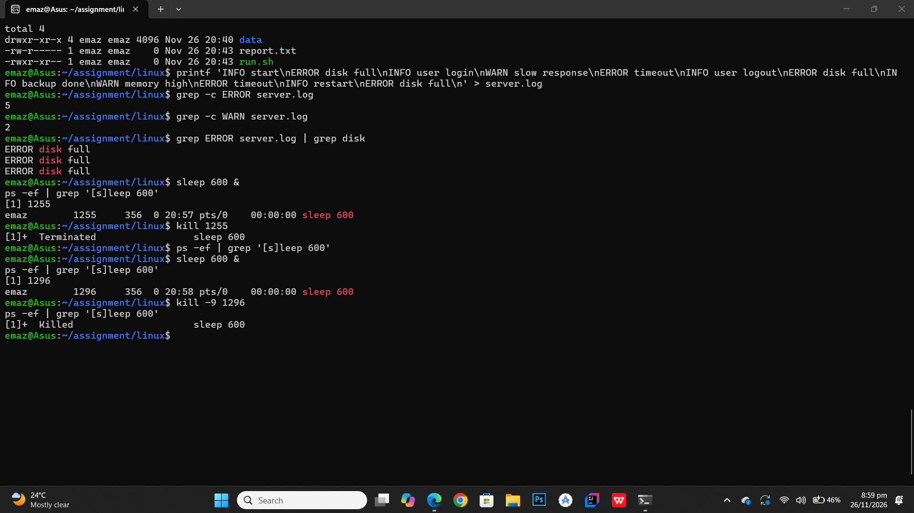

# DevOps Assignment 1 —Answers

Name: Emaz Ali Khan
Roll number: 65566
Section: 120823
Repository: https://github.com/EmazAliKhan/devops-assignment-1
PR (mine -> partner): 
PR (partner -> mine): 
Partner: 

---

## Part 1: DevOps concepts

### Part 1, Task 1

**Problem 1: Slow deployment.** Developers finish a feature in two weeks, but operations deploys only once every three months. The feature waits a long time to reach users, and many changes ship together, so one bad change can break the whole release.
**DevOps fix:** CI/CD pipelines and small, frequent releases. Automation makes deploying safe and fast, so lead time drops and each release is easier to test and roll back.

**Problem 2: Blame culture.** When a release breaks, operations blames the developers. Nobody shares ownership, so people hide mistakes instead of reporting them early.
**DevOps fix:** A blameless culture and shared responsibility. Dev and ops work together, run blameless post-mortems, and improve the process instead of blaming a person.

### Part 1, Task 2

The eight stages of the DevOps lifecycle, in order, with a free tool from the course:

1. **Plan** — GitHub Projects / Trello
2. **Code** — Git and GitHub
3. **Build** — npm / Maven
4. **Test** — JUnit / pytest
5. **Release** — GitHub Actions
6. **Deploy** — GitHub Actions / Ansible
7. **Operate** — systemd (systemctl)
8. **Monitor** — journalctl / Prometheus

### Part 1, Task 3

CALMS = Culture, Automation, Lean, Measurement, Sharing. One concrete action each:

- **Culture:** Run a blameless review after every failed merge or outage, so people report problems honestly.
- **Automation:** Write a script to back up the project and schedule it with cron instead of doing it by hand.
- **Lean:** Commit small changes often instead of one big commit at the end.
- **Measurement:** Track the four DORA metrics (deploy frequency, lead time, change failure rate, time to restore) in the repo.
- **Sharing:** Review each other's pull requests and leave helpful comments, and share notes in the repo.

### Part 1, Task 4

**(a) DORA metrics**
- Speed: **Deployment Frequency**, **Lead Time for Changes**
- Stability: **Change Failure Rate**, **Time to Restore Service**

**(b) Three Ways**
- Automated test that fails a push within minutes → **Feedback**
- Blameless review after an outage → **Continual learning**
- Releasing small changes every day instead of one big release → **Flow**

---

## Part 2: Linux command line

### Part 2, Task 1
Commands:
```bash
mkdir -p ~/assignment/linux/data/reports ~/assignment/linux/data/archive
ls -R ~/assignment/linux
```
Output:
```
emaz@Asus:~/devops-assignment-1$ ls -R ~/assignment/linux
/home/emaz/assignment/linux:
data

/home/emaz/assignment/linux/data:
archive  reports

/home/emaz/assignment/linux/data/archive:

/home/emaz/assignment/linux/data/reports:

```
Explanation:
`mkdir -p` creates the parent folders too, so `assignment/linux/data/reports` and `.../archive` are created in one go without errors if they already exist. `ls -R` lists the folders recursively so we can see the whole tree.

### Part 2, Task 2
Commands:
```bash
cd ~/assignment/linux
touch report.txt run.sh
chmod 640 report.txt
chmod 754 run.sh
ls -l
```
Output:
```
emaz@Asus:~/assignment/linux$ ls -l
total 4
drwxr-xr-x 4 emaz emaz 4096 Nov 26 20:40 data
-rw-r----- 1 emaz emaz    0 Nov 26 20:43 report.txt
-rwxr-xr-- 1 emaz emaz    0 Nov 26 20:43 run.sh

```
Screenshot: 

Explanation:
- `640` on report.txt = owner `rw-`, group `r--`, others `---`. The owner can read and write, the group can only read, everyone else gets nothing.
- `754` on run.sh = owner `rwx`, group `r-x`, others `r--`. The owner can read, write and execute; the group can read and execute; others can only read.

### Part 2, Task 3
Commands:
```bash
cd ~/assignment/linux
printf 'INFO start\nERROR disk full\nINFO user login\nWARN slow response\nERROR timeout\nINFO user logout\nERROR disk full\nINFO backup done\nWARN memory high\nERROR timeout\nINFO restart\nERROR disk full\n' > server.log
grep -c ERROR server.log
grep -c WARN server.log
grep ERROR server.log | grep disk
```
Output:
```
emaz@Asus:~/assignment/linux$ grep -c ERROR server.log
5
emaz@Asus:~/assignment/linux$ grep -c WARN server.log
2
emaz@Asus:~/assignment/linux$ grep ERROR server.log | grep disk
ERROR disk full
ERROR disk full
ERROR disk full

```
Explanation:
`grep -c ERROR` counts lines containing ERROR = 5. `grep -c WARN` counts WARN lines = 2. The pipe sends only ERROR lines into a second grep, which keeps only the ones that also contain "disk" = 3 lines.

### Part 2, Task 4
Commands:
```bash
sleep 600 &
ps -ef | grep '[s]leep 600'
kill 1255
ps -ef | grep '[s]leep 600'
sleep 600 &
ps -ef | grep '[s]leep 600'
kill -9 1296
ps -ef | grep '[s]leep 600'
```
Output:
```
emaz@Asus:~/assignment/linux$ sleep 600 &
ps -ef | grep '[s]leep 600'
[1] 1255
emaz        1255     356  0 20:57 pts/0    00:00:00 sleep 600
emaz@Asus:~/assignment/linux$ kill 1255
[1]+  Terminated                 sleep 600
emaz@Asus:~/assignment/linux$ ps -ef | grep '[s]leep 600'
emaz@Asus:~/assignment/linux$ sleep 600 &
ps -ef | grep '[s]leep 600'
[1] 1296
emaz        1296     356  0 20:58 pts/0    00:00:00 sleep 600
emaz@Asus:~/assignment/linux$ kill -9 1296
ps -ef | grep '[s]leep 600'
[1]+  Killed                     sleep 600

```
Screenshot: 

Explanation:
Plain `kill` sends SIGTERM (signal 15), which politely asks the process to stop and lets it clean up — the shell reports "Terminated". `kill -9` sends SIGKILL (signal 9), which the process cannot catch or ignore — it dies immediately, reported as "Killed". Use SIGTERM first; use SIGKILL only when a process ignores SIGTERM or is stuck.

### Part 2, Task 5
Commands:
```bash
whoami
groups
sudo apt update
```
Output:
```
-rwxr-xr-x 1 emaz emaz 191288 Nov 26 21:00 p2t4.png
emaz@Asus:~/assignment/linux$ whoami
emaz
emaz@Asus:~/assignment/linux$ groups
emaz adm cdrom sudo dip plugdev users
emaz@Asus:~/assignment/linux$ sudo apt update
[sudo: authenticate] Password:
Get:26 http://archive.ubuntu.com/ubuntu resolute-backports/universe amd64 Components [1056 B]
Fetched 5261 kB in 5s (1163 kB/s)
95 packages can be upgraded. Run 'apt list --upgradable' to see them.

```
Explanation:
`whoami` shows the current user is `emaz`. `groups` shows the groups that user belongs to — including `sudo`, which is the group allowed to run commands as superuser. Using `sudo` runs just one command with elevated rights, while the normal shell stays a normal user — so a typo or bad command cannot damage the whole system. Staying logged in as root means every command runs with full power and one mistake can break the machine.

---
