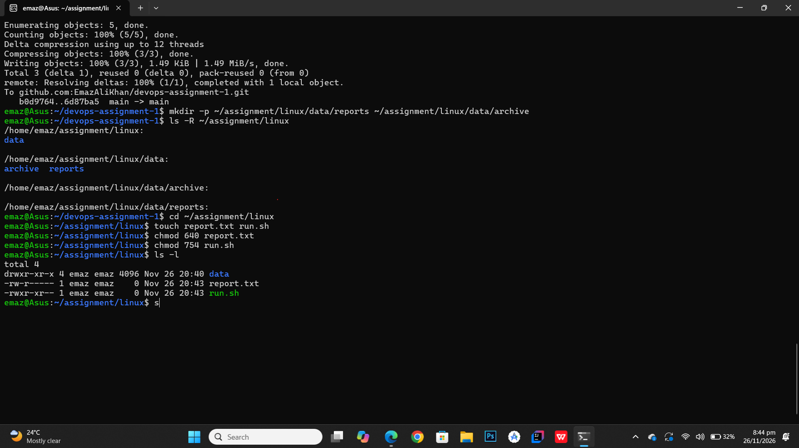

# DevOps Assignment 1 —Answers

Name: Emaz Ali Khan
Roll number: 65566
Section: 120823
Repository: https://github.com/EmazAliKhan/devops-assignment-1
PR (mine -> partner): https://github.com/sumaikasif/devops-assignment-1/pull/1
PR (partner -> mine): 
Partner: 

---

## Part 1: DevOps concepts

### Part 1, Task 1

**Problem 1: Slow deployment.** Developers finish a feature in two weeks, but operations deploys only once every three months. The feature waits a long time to reach users, and many changes ship together, so one bad change can break the whole release.
**DevOps fix:** CI/CD pipelines and small, frequent releases. Automation makes deploying safe and fast, so lead time drops and each release is easier to test and roll back.

**Problem 2: Blame culture.** When a release breaks, operations blames the developers. Nobody shares ownership, so people hide mistakes instead of reporting them early.
**DevOps fix:** A blameless culture and shared responsibility. Dev and ops work together, run blameless post-mortems, and improve the process instead of blaming a person.

### Part 1, Task 2

The eight stages of the DevOps lifecycle, in order, with a free tool from the course:

1. **Plan** — GitHub Projects / Trello
2. **Code** — Git and GitHub
3. **Build** — npm / Maven
4. **Test** — JUnit / pytest
5. **Release** — GitHub Actions
6. **Deploy** — GitHub Actions / Ansible
7. **Operate** — systemd (systemctl)
8. **Monitor** — journalctl / Prometheus

### Part 1, Task 3

CALMS = Culture, Automation, Lean, Measurement, Sharing. One concrete action each:

- **Culture:** Run a blameless review after every failed merge or outage, so people report problems honestly.
- **Automation:** Write a script to back up the project and schedule it with cron instead of doing it by hand.
- **Lean:** Commit small changes often instead of one big commit at the end.
- **Measurement:** Track the four DORA metrics (deploy frequency, lead time, change failure rate, time to restore) in the repo.
- **Sharing:** Review each other's pull requests and leave helpful comments, and share notes in the repo.

### Part 1, Task 4

**(a) DORA metrics**
- Speed: **Deployment Frequency**, **Lead Time for Changes**
- Stability: **Change Failure Rate**, **Time to Restore Service**

**(b) Three Ways**
- Automated test that fails a push within minutes → **Feedback**
- Blameless review after an outage → **Continual learning**
- Releasing small changes every day instead of one big release → **Flow**

---

## Part 2: Linux command line

### Part 2, Task 1
Commands:
```bash
mkdir -p ~/assignment/linux/data/reports ~/assignment/linux/data/archive
ls -R ~/assignment/linux
```
Output:
```
emaz@Asus:~/devops-assignment-1$ ls -R ~/assignment/linux
/home/emaz/assignment/linux:
data

/home/emaz/assignment/linux/data:
archive  reports

/home/emaz/assignment/linux/data/archive:

/home/emaz/assignment/linux/data/reports:

```
Explanation:
`mkdir -p` creates the parent folders too, so `assignment/linux/data/reports` and `.../archive` are created in one go without errors if they already exist. `ls -R` lists the folders recursively so we can see the whole tree.

### Part 2, Task 2
Commands:
```bash
cd ~/assignment/linux
touch report.txt run.sh
chmod 640 report.txt
chmod 754 run.sh
ls -l
```
Output:
```
emaz@Asus:~/assignment/linux$ ls -l
total 4
drwxr-xr-x 4 emaz emaz 4096 Nov 26 20:40 data
-rw-r----- 1 emaz emaz    0 Nov 26 20:43 report.txt
-rwxr-xr-- 1 emaz emaz    0 Nov 26 20:43 run.sh

```
Screenshot: 

Explanation:
- `640` on report.txt = owner `rw-`, group `r--`, others `---`. The owner can read and write, the group can only read, everyone else gets nothing.
- `754` on run.sh = owner `rwx`, group `r-x`, others `r--`. The owner can read, write and execute; the group can read and execute; others can only read.

### Part 2, Task 3
Commands:
```bash
cd ~/assignment/linux
printf 'INFO start\nERROR disk full\nINFO user login\nWARN slow response\nERROR timeout\nINFO user logout\nERROR disk full\nINFO backup done\nWARN memory high\nERROR timeout\nINFO restart\nERROR disk full\n' > server.log
grep -c ERROR server.log
grep -c WARN server.log
grep ERROR server.log | grep disk
```
Output:
```
emaz@Asus:~/assignment/linux$ grep -c ERROR server.log
5
emaz@Asus:~/assignment/linux$ grep -c WARN server.log
2
emaz@Asus:~/assignment/linux$ grep ERROR server.log | grep disk
ERROR disk full
ERROR disk full
ERROR disk full

```
Explanation:
`grep -c ERROR` counts lines containing ERROR = 5. `grep -c WARN` counts WARN lines = 2. The pipe sends only ERROR lines into a second grep, which keeps only the ones that also contain "disk" = 3 lines.

### Part 2, Task 4
Commands:
```bash
sleep 600 &
ps -ef | grep '[s]leep 600'
kill 1255
ps -ef | grep '[s]leep 600'
sleep 600 &
ps -ef | grep '[s]leep 600'
kill -9 1296
ps -ef | grep '[s]leep 600'
```
Output:
```
emaz@Asus:~/assignment/linux$ sleep 600 &
ps -ef | grep '[s]leep 600'
[1] 1255
emaz        1255     356  0 20:57 pts/0    00:00:00 sleep 600
emaz@Asus:~/assignment/linux$ kill 1255
[1]+  Terminated                 sleep 600
emaz@Asus:~/assignment/linux$ ps -ef | grep '[s]leep 600'
emaz@Asus:~/assignment/linux$ sleep 600 &
ps -ef | grep '[s]leep 600'
[1] 1296
emaz        1296     356  0 20:58 pts/0    00:00:00 sleep 600
emaz@Asus:~/assignment/linux$ kill -9 1296
ps -ef | grep '[s]leep 600'
[1]+  Killed                     sleep 600

```
Screenshot: 

Explanation:
Plain `kill` sends SIGTERM (signal 15), which politely asks the process to stop and lets it clean up — the shell reports "Terminated". `kill -9` sends SIGKILL (signal 9), which the process cannot catch or ignore — it dies immediately, reported as "Killed". Use SIGTERM first; use SIGKILL only when a process ignores SIGTERM or is stuck.

### Part 2, Task 5
Commands:
```bash
whoami
groups
sudo apt update
```
Output:
```
-rwxr-xr-x 1 emaz emaz 191288 Nov 26 21:00 p2t4.png
emaz@Asus:~/assignment/linux$ whoami
emaz
emaz@Asus:~/assignment/linux$ groups
emaz adm cdrom sudo dip plugdev users
emaz@Asus:~/assignment/linux$ sudo apt update
[sudo: authenticate] Password:
Get:26 http://archive.ubuntu.com/ubuntu resolute-backports/universe amd64 Components [1056 B]
Fetched 5261 kB in 5s (1163 kB/s)
95 packages can be upgraded. Run 'apt list --upgradable' to see them.

```
Explanation:
`whoami` shows the current user is `emaz`. `groups` shows the groups that user belongs to — including `sudo`, which is the group allowed to run commands as superuser. Using `sudo` runs just one command with elevated rights, while the normal shell stays a normal user — so a typo or bad command cannot damage the whole system. Staying logged in as root means every command runs with full power and one mistake can break the machine.

---


## Part 3: Git and GitHub

### Part 3, Task 1
Commands:
```bash
mkdir -p ~/devops-assignment-1
cd ~/devops-assignment-1
git init
git config user.name "Emaz Ali Khan"
git config user.email ">>> PASTE YOUR EMAIL HERE <<<"
git config user.name
git config user.email
```
Output:
```
emaz@Asus:~/devops-assignment-1$ git config user.name
Emaz Ali Khan
emaz@Asus:~/devops-assignment-1$ git config user.email
emaz.kiet26@gmail.com

```
Explanation:
`git init` creates the hidden `.git` folder that turns this folder into a repository. `git config user.name` and `user.email` set the identity recorded on every commit; the last two commands show the saved values.

### Part 3, Task 2
Commands:
```bash
touch README.md answers.md
printf '*.log\ntmp/\n.env\n' > .gitignore
touch server.log
mkdir -p tmp && touch tmp/placeholder.txt
touch .env
git status
git add README.md answers.md .gitignore
git commit -m "Part 3: repo skeleton with README, answers, gitignore"
```
Output:
```
On branch main

No commits yet

Untracked files:
  (use "git add <file>..." to include in what will be committed)
        .gitignore
        README.md
        answers.md
        greeting.txt
        notes.md

nothing added to commit but untracked files present (use "git add" to track)
emaz@Asus:~/devops-assignment-1$ git add README.md answers.md .gitignore notes.md greeting.txt screenshots scripts tips
emaz@Asus:~/devops-assignment-1$ git commit -m "Part 3: repo skeleton with README, answers, gitignore"
[main (root-commit) 05ec5c2] Part 3: repo skeleton with README, answers, gitignore
 5 files changed, 3 insertions(+)
 create mode 100644 .gitignore
 create mode 100644 README.md
 create mode 100644 answers.md
 create mode 100644 greeting.txt
 create mode 100644 notes.md

```
Explanation:
`.gitignore` lists `*.log`, `tmp/` and `.env`, so `git status` does not show `server.log`, the `tmp/` folder, or `.env`. Only `README.md`, `answers.md` and `.gitignore` are staged and committed. The ignored files stay on disk but Git never tracks them.

### Part 3, Task 3
Commands:
```bash
nano README.md
git status
git add README.md
git status
git commit -m "Part 3: update README"
git status
```
Output:
```
emaz@Asus:~/devops-assignment-1$ git add README.md
emaz@Asus:~/devops-assignment-1$ git status
On branch main
Your branch is up to date with 'origin/main'.

Changes to be committed:
  (use "git restore --staged <file>..." to unstage)
        modified:   README.md

emaz@Asus:~/devops-assignment-1$ git commit -m "Part 3: update README"
[main b29539a] Part 3: update README
 1 file changed, 2 insertions(+)
emaz@Asus:~/devops-assignment-1$ git status
On branch main
Your branch is ahead of 'origin/main' by 1 commit.
  (use "git push" to publish your local commits)

nothing to commit, working tree clean

```
Explanation:
1. After editing README.md, `git status` shows it under "Changes not staged" — the change is in the **working directory**.
2. After `git add`, `git status` shows it under "Changes to be committed" — the change is now in the **staging area**.
3. After `git commit`, `git status` says "nothing to commit, working tree clean" — the change is saved in the **repository**.

### Part 3, Task 4
Commands:
```bash
git remote add origin git@github.com:EmazAliKhan/devops-assignment-1.git
git branch -M main
git push -u origin main
git remote -v
git log --oneline
```
Output:
```
emaz@Asus:~/devops-assignment-1$ git push -u origin main
Enumerating objects: 4, done.
Counting objects: 100% (4/4), done.
Delta compression using up to 12 threads
Compressing objects: 100% (2/2), done.
Writing objects: 100% (4/4), 344 bytes | 344.00 KiB/s, done.
Total 4 (delta 0), reused 0 (delta 0), pack-reused 0 (from 0)
To github.com:EmazAliKhan/devops-assignment-1.git
 * [new branch]      main -> main
branch 'main' set up to track 'origin/main'.
emaz@Asus:~/devops-assignment-1$ git remote -v
origin  git@github.com:EmazAliKhan/devops-assignment-1.git (fetch)
origin  git@github.com:EmazAliKhan/devops-assignment-1.git (push)
emaz@Asus:~/devops-assignment-1$ git log --oneline
05ec5c2 (HEAD -> main, origin/main) Part 3: repo skeleton with README, answers, gitignore

```
Explanation:
`git remote add origin` links the local repo to the empty GitHub repo using the SSH URL. `git push -u origin main` uploads the commits and remembers the upstream, so later `git push` is enough. `git remote -v` shows the saved URL and `git log --oneline` shows the commit history.

---

## Part 4: Branching, merge conflicts and pull requests

### Part 4, Task 1
Commands:
```bash
cd ~/devops-assignment-1
git checkout -b add-notes
echo "line one" > notes.md
git add notes.md && git commit -m "Add notes.md"
echo "line two" >> notes.md
git add notes.md && git commit -m "Edit notes.md"
git checkout main
git merge add-notes
git branch -d add-notes
git log --oneline --graph
```
Output:
```
emaz@Asus:~/devops-assignment-1$ git checkout -b add-notes
Switched to a new branch 'add-notes'
emaz@Asus:~/devops-assignment-1$ echo "line one" > notes.md
emaz@Asus:~/devops-assignment-1$ git add notes.md && git commit -m "Add notes.md"
[add-notes 121c310] Add notes.md
 1 file changed, 1 insertion(+)
emaz@Asus:~/devops-assignment-1$ echo "line two" >> notes.md
emaz@Asus:~/devops-assignment-1$ git add notes.md && git commit -m "Edit notes.md"
[add-notes 26c7b13] Edit notes.md
 1 file changed, 1 insertion(+)
emaz@Asus:~/devops-assignment-1$ git checkout main
Switched to branch 'main'
Your branch is up to date with 'origin/main'.
emaz@Asus:~/devops-assignment-1$ git merge add-notes
Updating 43fae3b..26c7b13
Fast-forward
 notes.md | 2 ++
 1 file changed, 2 insertions(+)
emaz@Asus:~/devops-assignment-1$ git branch -d add-notes
Deleted branch add-notes (was 26c7b13).
emaz@Asus:~/devops-assignment-1$ git log --oneline --graph
* 26c7b13 (HEAD -> main) Edit notes.md
* 121c310 Add notes.md
* 43fae3b (origin/main) Part 3: Git workflow evidence
* b29539a Part 3: update README
* b551525 Part 2: Linux command line
* 6d87ba5 Part 1: DevOps concepts
* b0d9764 Add answers.md header
* 05ec5c2 Part 3: repo skeleton with README, answers, gitignore
emaz@Asus:~/devops-assignment-1$

```
Explanation:
The merge was a **fast-forward** because `main` had not moved since `add-notes` was created — Git simply moved the `main` pointer forward to the branch's last commit (`26c7b13`). No separate merge commit was needed because there were no diverging changes.

### Part 4, Task 2
Commands:
```bash
cd ~/devops-assignment-1
echo "Hello from main" > greeting.txt
git add greeting.txt && git commit -m "greeting from main"
git checkout -b branch-a
echo "Hello from A" > greeting.txt
git add greeting.txt && git commit -m "greeting from A"
git checkout main
git checkout -b branch-b
echo "Hello from B" > greeting.txt
git add greeting.txt && git commit -m "greeting from B"
git checkout main
git merge branch-a
git merge branch-b
cat greeting.txt
```
Output:
```
emaz@Asus:~/devops-assignment-1$ echo "Hello from main" > greeting.txt
emaz@Asus:~/devops-assignment-1$ git add greeting.txt && git commit -m "greeting from main"
[main 2f8e4bc] greeting from main
 1 file changed, 1 insertion(+)
emaz@Asus:~/devops-assignment-1$ git checkout -b branch-a
Switched to a new branch 'branch-a'
emaz@Asus:~/devops-assignment-1$ echo "Hello from A" > greeting.txt
emaz@Asus:~/devops-assignment-1$ git add greeting.txt && git commit -m "greeting from A"
[branch-a 0c78c33] greeting from A
 1 file changed, 1 insertion(+), 1 deletion(-)
emaz@Asus:~/devops-assignment-1$ git checkout main
Switched to branch 'main'
Your branch is ahead of 'origin/main' by 3 commits.
  (use "git push" to publish your local commits)
emaz@Asus:~/devops-assignment-1$ git checkout -b branch-b
Switched to a new branch 'branch-b'
emaz@Asus:~/devops-assignment-1$ echo "Hello from B" > greeting.txt
emaz@Asus:~/devops-assignment-1$ git add greeting.txt && git commit -m "greeting from B"
[branch-b c13d898] greeting from B
 1 file changed, 1 insertion(+), 1 deletion(-)
emaz@Asus:~/devops-assignment-1$ git checkout main
Switched to branch 'main'
Your branch is ahead of 'origin/main' by 3 commits.
  (use "git push" to publish your local commits)
emaz@Asus:~/devops-assignment-1$ git merge branch-a
Updating 2f8e4bc..0c78c33
Fast-forward
 greeting.txt | 2 +-
 1 file changed, 1 insertion(+), 1 deletion(-)
emaz@Asus:~/devops-assignment-1$ git merge branch-b
Auto-merging greeting.txt
CONFLICT (content): Merge conflict in greeting.txt
Automatic merge failed; fix conflicts and then commit the result.
emaz@Asus:~/devops-assignment-1$

emaz@Asus:~/devops-assignment-1$ cat greeting.txt
<<<<<<< HEAD
Hello from A
=======
Hello from B
>>>>>>> branch-b

```
Explanation:
`<<<<<<< HEAD` marks the version from the current branch (`main`, which now has branch-a's content), `=======` separates the two versions, and `>>>>>>> branch-b` marks the end of the incoming version from branch-b. Git cannot resolve this automatically because both branches changed **the same line** in different ways — only a human knows which version (or combination) to keep.
Commands to resolve:
```bash
nano greeting.txt    # keep both lines, delete the marker lines
git add greeting.txt
git commit -m "Resolve greeting conflict: keep both A and B"
cat greeting.txt
```
Output:
```
emaz@Asus:~/devops-assignment-1$ nano greeting.txt
emaz@Asus:~/devops-assignment-1$ git add greeting.txt
emaz@Asus:~/devops-assignment-1$ git commit -m "Resolve greeting conflict: keep both A and B"
[main 54ecdb2] Resolve greeting conflict: keep both A and B
emaz@Asus:~/devops-assignment-1$ cat greeting.txt

Hello from A
Hello from B
```
Explanation:
I kept both greetings on separate lines and removed all three conflict markers, then `git add` told Git the conflict is resolved and `git commit` finished the merge.

### Part 4, Task 3
PR links:
- My PR to partner (sumaikasif): https://github.com/sumaikasif/devops-assignment-1/pull/1
- Partner's PR to me:
Explanation:
I forked sumaikasif's repository (renamed my fork to `devops-assignment-1-sumaikasif` because I already had a repo with the original name), cloned it locally, created the branch `add-emaz-tip`, added `tips/emaz.md` with three lines of DevOps advice, committed, and pushed the branch. I then opened a pull request to sumaikasif's main branch with the title "Add Emaz's DevOps tip" and a clear description. I will review sumaikasif's pull request to my repository once it is opened: leave two comments (one on a specific line), approve, and merge.

### Part 4, Task 4
Commands:
```bash
cd ~/devops-assignment-1
echo "Part 6 notes placeholder" >> notes.md
git add notes.md
git commit -m "Add Part 6 notes

Closes #1"
git push
```
Output:
```
emaz@Asus:~/sumaikasif-fork$ cd ~/devops-assignment-1
emaz@Asus:~/devops-assignment-1$ echo "Part 6 notes placeholder" >> notes.md
emaz@Asus:~/devops-assignment-1$ git add notes.md
emaz@Asus:~/devops-assignment-1$ git commit -m "Add Part 6 notes
> Closes #1"
[main 4541492] Add Part 6 notes Closes #1
 1 file changed, 1 insertion(+)
emaz@Asus:~/devops-assignment-1$ git push
Enumerating objects: 24, done.
Counting objects: 100% (23/23), done.
Delta compression using up to 12 threads
Compressing objects: 100% (14/14), done.
Writing objects: 100% (21/21), 1.67 KiB | 342.00 KiB/s, done.
Total 21 (delta 8), reused 0 (delta 0), pack-reused 0 (from 0)
remote: Resolving deltas: 100% (8/8), completed with 1 local object.
To github.com:EmazAliKhan/devops-assignment-1.git
   43fae3b..4541492  main -> main
```
Issue link: https://github.com/EmazAliKhan/devops-assignment-1/issues/1
Explanation:
The commit message contains `Closes #1`, so when the commit reached `main` on GitHub, the issue was closed automatically by GitHub's keyword linking. The issue `Add Part 6 notes` had the `documentation` label as the task asked.

---
